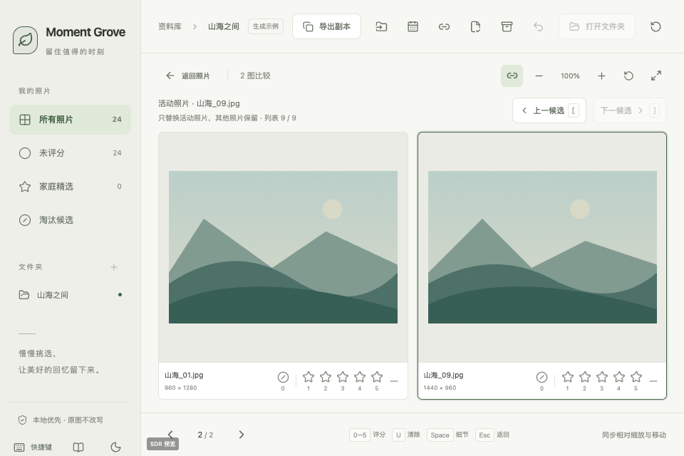

# Grove

给回忆，一点留白。A local-first desktop app for reviewing and organizing photos.

**0.14.0 targets technical trial users on Apple Silicon Macs.** [Website](https://grove.outerepoch3.chatgpt.site) · [Releases](https://github.com/liyunhui0707/grove/releases) The app interface is currently Chinese. It runs locally without an account or a separate Node.js installation.



*Browser preview using generated demo artwork; this is not a photograph or a native macOS screenshot.*

Expand folders to review one branch at a time. Export selections larger than 100 photos and reopen a folder of completed batches to review the results.

## What you can do in 0.14.0

- Preview static 8/16-bit SDR PNG in sRGB, including grayscale, transparency and Display P3. Detail failures retain the screen preview; discovered preview issues are grouped under library tools.
- Browse ordinary folders, review photos with keyboard ratings, undo, and compare 2–8 images.
- Resume the last folder, exact photo and essential review settings after a normal quit. Normal exit waits for in-flight rating/undo and the resulting final checkpoint; failures keep the window open for return or retry without automatically repeating rating operations.
- See the app version, build and data location; opening the same catalog again brings its existing window forward. On filesystems providing a persistent volume UUID, reconnecting the same disk keeps file identities; an offline or replaced root cannot be reported as a completed scan.
- Remember six watermark appearance settings. Each new batch clears city and fallback date; historical batches retain their original parameters.
- Keep comparison references visible while replacing only the active candidate with `[` / `]`, including while an earlier rating saves. Pending writes keep their original target; extra rating/undo input is explicitly reported as unexecuted, not queued.
- On macOS 14+, view tested Apple gain-map JPEG/HEIC and 10-bit PQ HEIC as SDR and export independent sRGB watermark JPEGs. HDR appearance is not retained.
- See explicit counts for skipped video, RAW and unsupported images in mixed folders. Recognized Live Photo markers and same-name video/RAW companions are labeled for static review; original export copies a unique same-name still and MOV with matching Apple content identifiers and verifies both files; ambiguous groups are refused, while watermark exports can create independent static JPEGs.
- Read orientation-correct JPEG/HEIC dimensions and EXIF capture dates; rebuild previews with a corrected source profile for affected phone HEIC thumbnails.
- Reuse the natural-name sorter for large photo batches; distinct occurrences and rating targets remain separate.
- Keep seven distinct states: unreviewed, reject candidate (0), and ratings 1–5. A reject rating never deletes a file. Use the explicit macOS “Move to Trash” action for selected zero-rated photos (1–100 per batch), with confirmation and existing XMP handling. No permanent deletion or automatic retry; Finder restoration is separate from rating undo.
- Carry ratings in XMP sidecars, review conflicts, and create local catalog snapshots.
- Collect 4–5-star photos and export verified original-byte copies.
- Export separate sRGB JPEGs with an optional date and city inside the photo. Grove looks up cities offline. Edit or clear the city for each photo and choose JPEG-only output for sharing. If the capture date is missing, enter a fallback or leave it blank. Choose original size or a 2048/4096-pixel long edge, and JPEG quality 80/92/98; smaller images are never enlarged.
- Review same-volume moves and low-rating isolation, with durable logs and reviewed withdrawal.

## Download and install

Download the exact macOS arm64 ZIP or DMG and `SHA256SUMS.txt` from [0.14.0 test prerelease](https://github.com/liyunhui0707/grove/releases/tag/v0.14.0). Both archives contain the same app, user guide and license notices. Check the archive before opening it:

```sh
shasum -a 256 --check --strict --ignore-missing SHA256SUMS.txt
```

Keep the checksum file and the chosen ZIP or DMG in the same folder. Require `OK` and a successful exit; if no file is verified or a checksum fails, stop without extracting or running it. Checksums detect changes; they are not an independent developer signature.

Open the DMG and drag **Grove.app** to Applications, or extract the ZIP and copy the app. Quit any older copy before replacing it.

**Signing:** ad-hoc signed, without Developer ID or Apple notarization. macOS may block the first opening. Follow [Apple's instructions for opening software from an unidentified developer](https://support.apple.com/guide/mac-help/open-a-mac-app-from-an-unidentified-developer-mh40616/mac) only if you trust the source. No security-disabling commands are required. A browser-download Gatekeeper flow has not been accepted as part of this prerelease.

**Native delivery evidence:** exact installed-package, upgrade/rollback and downloaded-asset results are recorded in the [build manifest](docs/build-manifest.json). Tests use generated or attributed inputs, not a promise for every photo library. Browser-quarantine/Gatekeeper first opening remains unaccepted.

**System scope:** arm64 / Apple Silicon; tested on macOS 27.2.1. The bundle declares macOS 12 as its minimum, but other OS versions, Intel Macs, Windows and Linux have not been validated for this release.

## First use

Choose **体验示例图库** for generated demo photos, or open a folder of disposable test copies. This is an early prerelease: keep independent media backups and use test copies for file operations.

Use 0–5 to rate, U to clear, ⌘Z to undo, and C to compare a selection. Ratings save to the local catalog; **评分同步** explicitly writes XMP. **导出照片 → 原格式副本** preserves original bytes and metadata. Watermark exports omit the source EXIF/GPS. Review every file-operation plan before confirming.

See [installation, upgrade and rollback](docs/installation-upgrade.md), the [user guide](docs/user-guide.md), [format support](docs/format-support.md), and [release notes](docs/release-notes.md).

## Privacy, updates and recovery

The app does not upload photos, require an account, query online city services, or perform automatic updates. System file pickers determine which folders it can use. Catalog snapshots contain ratings/catalog data, not photo backups.

Update manually: create a catalog snapshot, quit the app, keep the old app, and replace it. Withdrawal must precede catalog restoration when safe moves exist. Rollback is limited to the exact pairs and data described in the release evidence; arbitrary version rollback is not promised. Retain the old app and an independent catalog snapshot before replacing it. Uninstalling the app does not automatically erase the photo folder or application data.

## Local trial and update scope

The accepted isolated candidate is opened with `npm run desktop:open`; `npm run desktop:open -- --info` reports its version/build and independent data scope. Opening the public app directly uses its daily catalog instead.

Version 0.10.0 adds explicit hidden-selection counts, **查看已选**, a unified **导出照片** panel, completed-export folder actions, readable recovery prompts and native macOS task menus. Includes next-photo preview preparation from the preceding local stage. See [stage evidence](docs/experience-remediation-stage.md).

Version **0.8.0** adds persistent volume identities and static-photo exports for recognized associated resources. It upgrades the catalog to schema3, creating a coherent schema2 snapshot first. Older versions refuse schema3; rollback requires the pre-upgrade catalog and settings rather than directly sharing the upgraded data. Finish or withdraw older file-operation jobs before updating. See the [upgrade limits](docs/installation-upgrade.md).

## Build from source

Use an existing Rust toolchain, a Node.js version satisfying the locked Vite package's engine requirement, and the [Tauri platform prerequisites](https://v2.tauri.app/start/prerequisites/).

```sh
npm ci
npm run desktop
```

Static checks and tests:

```sh
npm run build
npm test
npm run test:rust
npm run test:ui
npm run check:rust
node --test scripts/tests/release-version.test.mjs
```

Browser checks require installed Google Chrome. macOS decoder tests use system ImageIO/ColorSync and generated fixtures; the optional mobile matrix additionally uses attributed samples and a separate Core Image SDR reference; other platforms are not supported by this release. Performance and destructive-fault helper cases are opt-in and should only run in an owned test environment.

To build the macOS arm64 prerelease archives:

```sh
npm run desktop:package -- --prerelease
```

The repository root is the canonical product workspace. Read [contributor instructions](AGENTS.md), [current status](docs/current-status.md), and the [Git workflow](docs/git-workflow.md) before changing it. Use local feature branches and explicit stage commits; local commits do not authorize pushes or releases.

Packaging writes to ignored `.local/deliveries/`, uses an offline Cargo build after dependencies are available, and performs no upload. The package has no automatic-update service. There are no GitHub Actions workflows that publish on push or tags.

## Feedback and license

Report reproducible problems in [Issues](https://github.com/liyunhui0707/grove/issues). Include the app version, macOS version and steps. Remove private paths, photo metadata and personal images before sharing logs or screenshots. See [security reporting](SECURITY.md) for sensitive reports.

Project code is [Apache-2.0](LICENSE). Dependencies retain their own licenses; full texts and source links are in [third-party notices](THIRD-PARTY-NOTICES.txt). macOS system frameworks and fonts are not bundled. No libheif, FFmpeg, cloud service or AI model is shipped.


## Startup and rating recovery in 0.5.1

The startup screen can report a module, first-render or waiting code and offers manual retry only before the first UI commit. It never automatically reloads an active review. The app activates its main window on launch. A bounded local `startup.json` retains this and the previous startup's fixed stages, build/version and timings; it contains no photo data, paths or exception text and is not uploaded. An unreadable or unsupported record is preserved and does not prevent use.

After a failed or uncertain rating/undo response, writes pause until a complete reread of the same folder includes all affected photos. Mutations are never automatically replayed; successful reconciliation discards frontend undo tokens. See the [release notes](docs/release-notes.md) for scope and remaining limitations. An earlier blank window's root cause remains unconfirmed; this release does not claim to solve every WebView or runtime-rendering failure.
